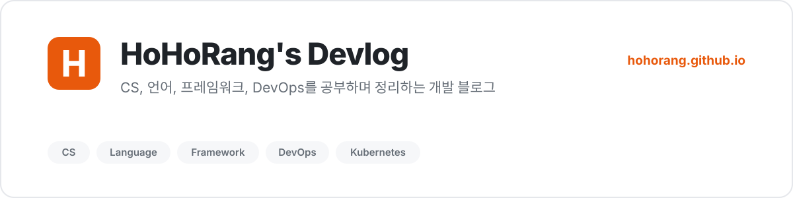

<a href="https://hohorang.github.io">
  <picture>
    <source media="(prefers-color-scheme: dark)" srcset="./assets/banner-dark.svg">
    
  </picture>
</a>

## 👋 Hi, I'm HoHoRang

공부한 내용과 개발하면서 겪은 문제를 기록합니다.
CS 기초, 언어와 프레임워크, 그리고 쿠버네티스와 리눅스 같은 인프라 쪽을 주로 다룹니다.

  
  

## 🛠 Tech Stack

  
  
  
  
  
  
  
  
   
  
  
  
  
  

